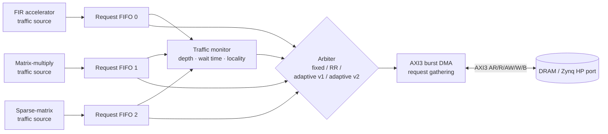

# Adaptive Memory and DMA Architecture for Heterogeneous FPGA-SoCs


A traffic-aware DMA and AXI arbitration subsystem for an FPGA-SoC in which several hardware accelerators
share one DRAM port. The arbiter watches runtime traffic (queue depth, waiting time, burst locality) and
adapts its grant decisions, instead of using a fixed priority or blind round robin.

The design was taken from RTL through **simulation, lint, formal, coverage, synthesis, equivalence checking,
place-and-route and static-timing sign-off** with the Cadence flow on the 45 nm gsclib045 library.
The Zynq-7020 FPGA implementation is the next stage (see [Roadmap](#roadmap)).

---

## Highlights

| | Result |
|---|---|
| Throughput | **+10–28 %** vs round robin under contention (adaptive v2) |
| Latency | Lowest average and worst-case latency of all four arbiters (HEAVY: 87 / 145 cycles vs 117 / 186 for RR) |
| DRAM locality | Row-hit rate **15 % → 32 %** under heavy load |
| Verification | 37-run Xcelium regression all PASS · 42/42 functional bins · 100 % FSM coverage |
| Static checks | HAL lint 0 unexplained findings · Jasper Superlint formal proof of the starvation bound |
| Synthesis | 333 MHz at the slow corner · +9.5 % area / +15 % power over round robin · Conformal LEC PASS |
| Physical design | Innovus: 0 DRC, 24 ps clock skew · Tempus MMMC sign-off: setup +0.016 ns, hold +0.298 ns |

---

## Architecture



**Blocks**

- **Traffic sources** model three accelerators with different access patterns: streaming (FIR), strided
  (matrix multiply) and irregular (sparse matrix).
- **Per-channel request FIFOs** absorb bursty traffic and apply backpressure to the source.
- **Traffic monitor** measures per-channel occupancy, waiting time and address locality.
- **Arbiters** (selected by parameter, for a fair comparison in the same system):
  - *Fixed priority*: baseline, starves low-priority channels.
  - *Round robin*: baseline, fair per grant but ignores DRAM locality.
  - *Adaptive v1*: weighted score from the monitor's metrics.
  - **Adaptive v2**: v1 plus a **missed-grant starvation override** (formally proven bounded at 15)
    and a **4-grant burst hold** that keeps a channel on the bus while it hits the same DRAM row.
- **AXI3 burst DMA** gathers contiguous requests into bursts and checks every response (`err_status` on
  SLVERR / bad ID).

---

## Results

### Performance (end-to-end with AXI3 DMA and a DRAM-like memory model, 5000 cycles)

| Scenario | Metric | Fixed | RR | Adaptive v1 | **Adaptive v2** |
|---|---|---|---|---|---|
| HEAVY | Throughput (beats/cycle) | 0.830* | 0.442 | 0.489 | **0.566** |
| HEAVY | Avg / max latency (cycles) | 32 / starved | 117 / 186 | 103 / 183 | **87 / 145** |
| BALANCED | Throughput | 0.463* | 0.502 | 0.486 | **0.553** |
| SLOW_DRAM | Throughput | 0.377* | 0.295 | 0.245 | **0.350** |
| HEAVY | DRAM row-hit rate | 100 %* | 15 % | 19 % | **32 %** |
| LOW | p99 latency | 32 | 46 | 33 | **30** |

\* Fixed priority reaches high throughput only by starving the lower-priority channels.

**Known limitation:** fairness is per *grant*, not per *byte* (Jain index 0.71–0.87 with bursting,
0.99+ without). Beat-based (deficit) accounting is listed as future work.

### Synthesis (Genus, slow corner, 3.0 ns / 333 MHz)

| Arbiter | Area (µm²) | Power (mW) | vs round robin |
|---|---|---|---|
| Fixed | 58,246 | 17.45 | |
| Round robin | 59,066 | 17.28 | baseline |
| Adaptive v1 | 64,612 | 19.79 | +9.4 % area, +14.5 % power |
| Adaptive v2 | 64,657 | 19.94 | +9.5 % area, +15.4 % power |

All four configurations meet timing. Conformal LEC: PASS for every configuration (~4,150–4,260 compared
points, 0 non-equivalent, 0 aborted).

**Critical path:** FIFO-head 16:1 mux → burst-gather address check + AR issue/accept → arbiter → request mux.
The arbiter contributes only ~0.05 ns; the DMA's same-cycle accept chain is the limiter. A registered-head
FIFO is the planned fix for 400 MHz.

### Physical design and sign-off (adaptive v2, 3.0 ns)

| Check | Result |
|---|---|
| Innovus post-route setup / hold | WNS +0.007 ns / +0.021 ns, 0 violating paths |
| **Tempus sign-off** (setup @ slow, hold @ fast, OCV + CPPR, SPEF, post-CTS SDC) | setup **+0.016 ns**, reg→reg +0.094 ns, hold **+0.298 ns**, no max-tran/cap/fanout violations |
| DRC / connectivity | 0 violations / clean |
| CCOpt clock tree | skew 24 ps (target 50 ps), insertion 239–263 ps |
| Utilization | 57.3 % (99.3 % with fillers), 9 routing layers, power ring + stripes on Metal9/Metal8 |
| Post-route power | ~17.3 mW |

<!-- Add your screenshots here once taken:


-->

---

## Verification

- **Self-checking testbench:** scoreboard, AXI3 protocol checker (8 rules), drain check, starvation-bound check.
- **Stimulus:** 5 load scenarios × 4 arbiters, random AXI backpressure, contiguous-access scenario,
  single-channel runs, error injection (SLVERR, bad RID, bad BID).
- **Coverage (IMC, 37 runs merged):** 42/42 functional bins, 100 % FSM, 100 % block/expression of reachable
  code with documented exclusions ([`cov/EXCLUSIONS.md`](cov/EXCLUSIONS.md)).
- **Lint:** Verilator `-Wall` clean; Cadence HAL 0 unexplained findings, every waiver justified
  ([`lint/WAIVERS.md`](lint/WAIVERS.md)).
- **Formal (Jasper Superlint):** 0 overflows; proofs that the v2 missed-grant counter never exceeds 15
  (starvation bound), that the last-granted channel is never overdue, and that the score never saturates.

**Bugs the process found:** coverage exposed 4 untested paths (write gathering, gathering on two channels,
AXI wait states, error logic) and a testbench bug (AXI checker register width); lint exposed unchecked AXI
responses (fixed with `err_status`); Superlint flagged a latent score overflow (fixed with saturation).

---

## Repository layout

```
.
├── rtl/            SystemVerilog design (one module per file)
├── tb/             Testbench, scoreboard, AXI3 protocol checker, memory model
├── lint/           HAL / Superlint / Verilator scripts and WAIVERS.md
├── cov/            Coverage scripts and EXCLUSIONS.md
├── syn/            Genus synthesis + Conformal LEC scripts, SDC
├── pnr/            Innovus P&R and Tempus sign-off scripts
├── results/        Performance tables (.md / .csv) and selected tool reports
├── docs/           Architecture notes, FPGA plan, images
├── run.sh, run3.sh, explore.sh, summarize.py   Simulation / sweep drivers
└── RESULTS.md      Full results summary
```

---

## How to run

Requires Cadence Xcelium, Jasper, IMC, Genus, Conformal, Innovus and Tempus, and the gsclib045 45 nm library.
Library paths are set at the top of the `syn/` and `pnr/` scripts; edit them for your installation.
Use a project path **without spaces** (Innovus fails on paths containing spaces).

```sh
chmod +x run.sh run3.sh explore.sh lint/run_lint.sh syn/*.sh pnr/*.sh

./run3.sh xrun sweep          # regression: all scenarios x all arbiters
./run3.sh xrun cov            # regression with coverage collection
./lint/run_lint.sh hal        # HAL lint
./lint/run_lint.sh superlint  # Jasper Superlint (formal)
./syn/run_syn.sh              # Genus synthesis, all arbiters
./syn/run_lec.sh              # Conformal equivalence check
./pnr/run_pnr.sh              # Innovus place and route (adaptive v2)
./pnr/run_sta.sh              # Tempus sign-off STA
```

---

## Roadmap

- [x] RTL: FIFOs, traffic monitor, four arbiters, AXI3 burst DMA
- [x] Verification: regression, coverage closure, error injection
- [x] Lint and formal checks
- [x] Synthesis, LEC, P&R, sign-off STA (45 nm)
- [ ] **Zynq-7020 implementation** (Vivado): AXI-Lite register block (arbiter mode, weights, thresholds,
      performance counters), block design with the PS HP port, Vitis bare-metal test application,
      on-board throughput/latency measurement. See [`docs/FPGA_PLAN.md`](docs/FPGA_PLAN.md).
- [ ] Registered-head FIFOs for 400 MHz
- [ ] Beat-based (byte-fair) arbitration
- [ ] Activity-based power (VCD/TCF into Joules/Voltus) and IR-drop analysis

---

## Lessons learned

- **The bottleneck was not where expected:** the adaptive arbiter costs ~5,000 µm² but only ~0.05 ns; the
  DMA's same-cycle accept chain sets Fmax.
- **Throughput vs Fmax:** a smarter arbiter costs ~10 % area and gains up to 28 % throughput at the same clock.
- **Sign-off correlation:** post-route timing needs separate setup/hold views (not one view with
  -max/-min libraries) and the post-CTS SDC with propagated clocks, otherwise Innovus and Tempus disagree.
- **LEF matters:** routing failed until the LEF with fixed via definitions was used.
- **Coverage pays off:** the four untested paths it found included real error-handling logic.

---

## Contributors

| Name | Role |
|---|---|
| **Nikshitha N Shetty** ([@nikshithashetty-lgtm](https://github.com/nikshithashetty-lgtm)) | Architecture, RTL, verification, synthesis, physical design and sign-off |

M.E. VLSI, Manipal School of Information Sciences (MSIS), Manipal.

## License

MIT, see [LICENSE](LICENSE). The gsclib045 library and Cadence tools are not included and are subject to
their own licenses.
